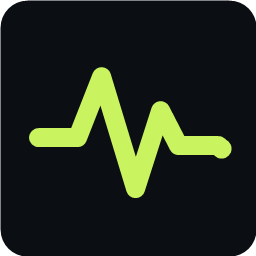
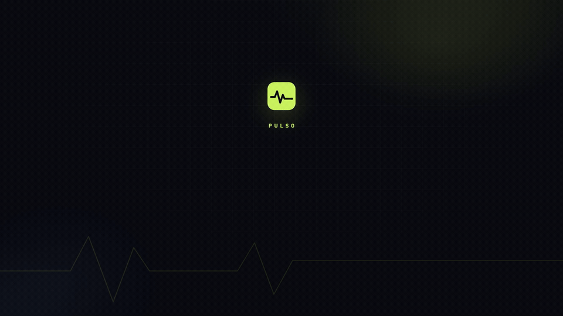
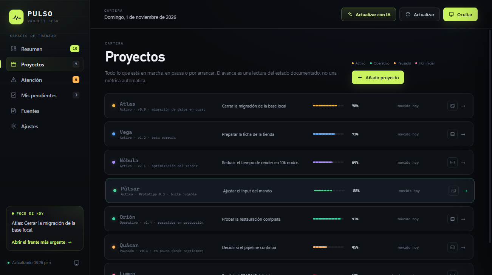
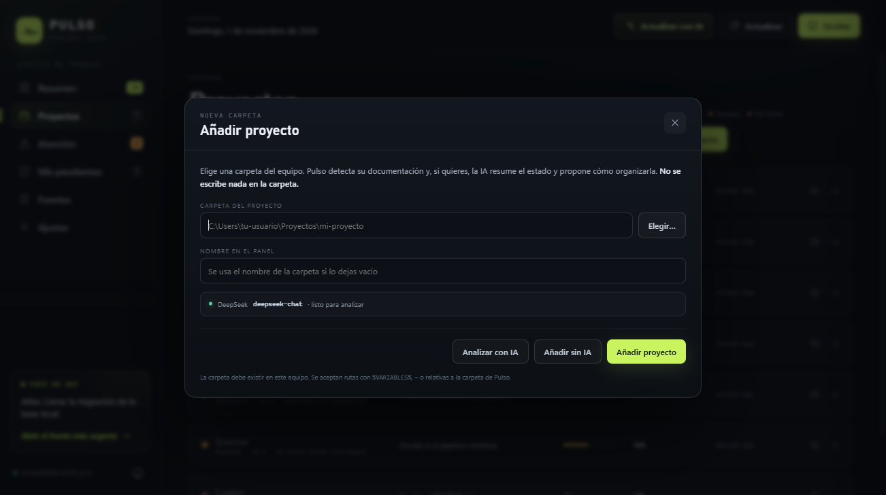
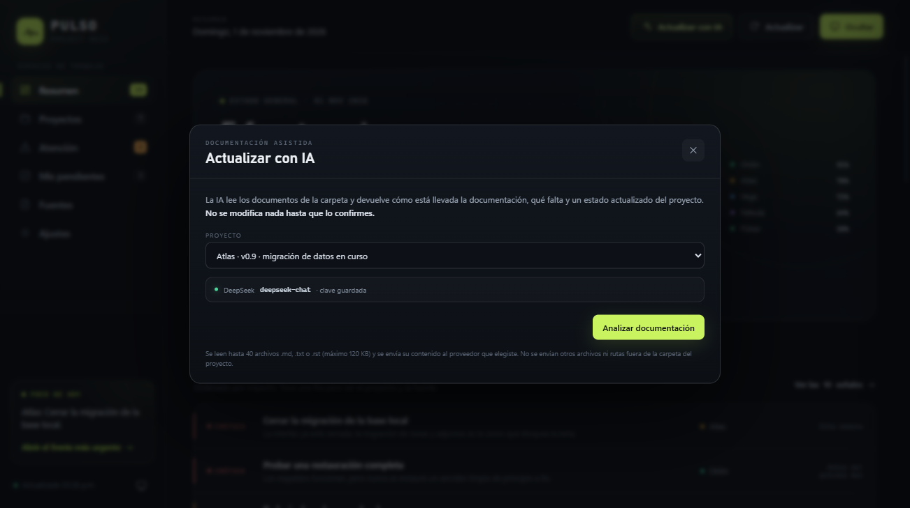
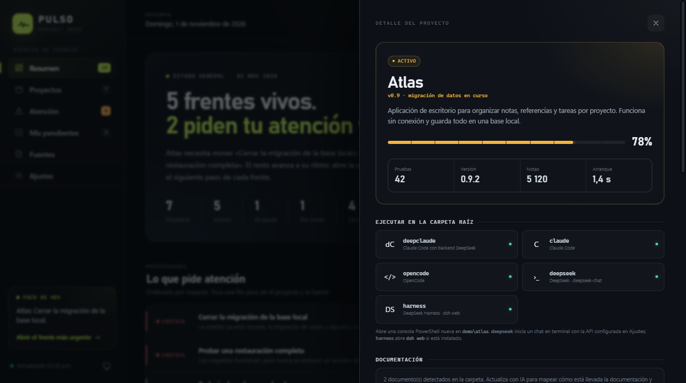
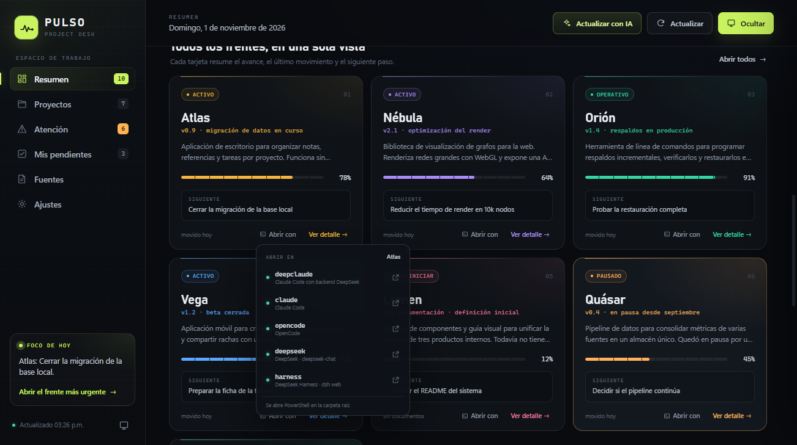
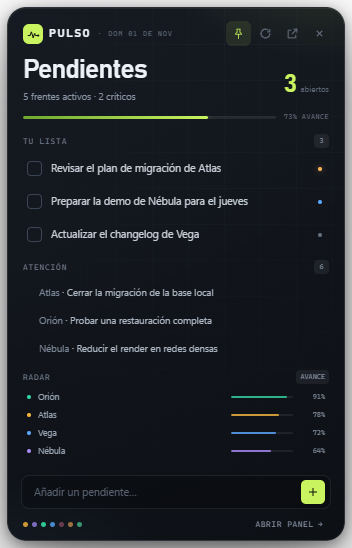

<p align="center">
  
</p>

<h1 align="center">Pulso</h1>

<p align="center">
  El estado real de tus proyectos y tus pendientes, en un solo panel local para Windows.
</p>

<p align="center">
  
  
  
  
  <a href="https://notSickboy.github.io/Pulso/"></a>
</p>

<p align="center">
  
</p>

Panel de escritorio para llevar el estado de tus proyectos y un widget de
pendientes siempre visible en Windows. Lee la documentación que ya existe en
cada carpeta, la resume y te deja el siguiente paso a la vista. Si quieres, puedes
conectar tu propia API para reorganizar esa documentación y detectar lo que falta.

Hecho con Electron. Sin cuentas, sin telemetría y sin servicios intermedios: los
datos viven en tu equipo.

## Qué incluye

- **Resumen** con avance medio, frentes activos, señales de atención y decisiones
  abiertas.
- **Proyectos** con estado, avance, último movimiento y siguiente paso. Cada fila
  abre un detalle con lo hecho, lo pendiente, riesgos, métricas y documentos.
- **Añadir proyecto** desde una carpeta existente, con detección automática de
  documentación y análisis opcional por IA.
- **Atención** con señales priorizadas extraídas de los documentos.
- **Mis pendientes** sincronizados en vivo con el widget del escritorio.
- **Fuentes** con los documentos que alimentan el panel y su fecha de
  modificación.
- **Actualizar** sin IA: vuelve a leer las carpetas, descubre documentos nuevos y
  avisa de carpetas o proyectos sin documentación.
- **Actualizar con IA**: lee la documentación, propone cómo organizarla, resume el
  estado real y ofrece crear los documentos que faltan. Nada se escribe hasta que
  lo confirmas.
- **Abrir con**: lanza un agente en la carpeta del proyecto desde el panel.



## Instalación

Requisitos: Windows 10 u 11, Node.js 20 o superior y npm.

```powershell
git clone <url-del-repositorio>
cd Dashboard
npm install
npm start
```

Para abrir el panel y el widget sin ventana de consola, usa `Iniciar Pulso.vbs`.
Si quieres un acceso directo en el escritorio:

```powershell
powershell -ExecutionPolicy Bypass -File ".\Crear acceso directo.ps1"
```

### Probar con datos ficticios

```powershell
npm run demo
```

La demo usa `data/projects.demo.json`, carpetas de ejemplo en `demo/` y un perfil
temporal aparte. No toca tus proyectos ni tus pendientes reales.

## Cómo se usa

### Actualizar sin IA

El botón **Actualizar** de la barra superior vuelve a leer el disco. No llama a
ninguna API y funciona en cualquier equipo:

- Comprueba que la carpeta de cada proyecto exista.
- Relee las fechas de los documentos declarados en `data/projects.json`.
- Si un proyecto no tiene documentos declarados, descubre automáticamente los
  `.md`, `.txt` y `.rst` de su carpeta, y añade los documentos nuevos que
  aparezcan aunque la lista ya tenga entradas.
- Muestra un resumen: proyectos, documentos, carpetas sin acceso y proyectos sin
  documentación.

Las rutas aceptan `%VARIABLES%` de entorno, `~` para tu carpeta de usuario y rutas
relativas a la carpeta de Pulso.

### Añadir un proyecto

En **Proyectos → Añadir proyecto**:

1. Escribe la ruta o usa **Elegir…** para seleccionar la carpeta.
2. Ponle un nombre (si lo dejas vacío se usa el nombre de la carpeta).
3. Pulsa **Analizar con IA** para que se lea la documentación y se proponga el
   estado y el mapa de documentos, o **Añadir sin IA** para incorporarlo tal cual.

Pulso no mueve, renombra ni sobrescribe archivos de la carpeta.



### Actualizar con IA

En **Ajustes → Inteligencia artificial** elige proveedor, modelo y pega tu clave:

| Proveedor | Modelo por defecto |
|---|---|
| DeepSeek | `deepseek-chat` |
| OpenAI | `gpt-4.1-mini` |
| Claude | `claude-sonnet-4-5` |

La clave se cifra con el almacén seguro del sistema (`safeStorage`) y nunca se
devuelve a la interfaz. Puedes probar la conexión antes de usarla.

Al pulsar **Actualizar con IA**:

- Se leen hasta 40 documentos `.md`, `.txt` o `.rst` de la carpeta (máximo 120 KB).
- Se envía ese contenido al proveedor que elegiste, y nada más.
- La respuesta se muestra como vista previa: estado, avance, resumen, pasos,
  riesgos, mapa canónico y documentos que faltan.
- **Aplicar al panel** actualiza la entrada de `data/projects.json` y guarda antes
  una copia `.bak`.
- **Crear documentación** propone archivos nuevos. Solo escribe rutas `.md`
  dentro de la carpeta del proyecto y nunca sobrescribe un archivo existente.



### Detalle del proyecto



## Agentes en la carpeta del proyecto

Cada proyecto tiene un botón **Abrir con** que lanza una consola PowerShell nueva
en su carpeta raíz:

| Agente | Qué ejecuta |
|---|---|
| `deepclaude` | Claude Code con backend DeepSeek |
| `claude` | Claude Code |
| `opencode` | OpenCode |
| `deepseek` | Chat en terminal con la API configurada en Ajustes |
| `harness` | DeepSeek Harness (`dsh web`) |

La detección se hace al abrir el menú. Si un agente no está instalado o no se
encuentra en `PATH`, su opción aparece desactivada. `deepclaude` se busca en
`%DEEPCLAUDE_SCRIPT%`, `C:\deepseek-proxy\deepclaude\deepclaude.ps1`,
`~\.deepclaude\deepclaude.ps1` y `~\deepclaude\deepclaude.ps1`.



## Widget de escritorio

- Se ancla al escritorio de Windows: queda detrás de las ventanas normales y no
  aparece en la barra de tareas ni en Alt+Tab.
- Sigue visible al pulsar **Win+D** o minimizar todo.
- Muestra pendientes abiertos, señales urgentes y el radar de avance.
- Permite añadir un pendiente y marcar tareas como hechas sin abrir el panel.
- El botón de pin lo devuelve a modo ventana flotante; desde Ajustes puedes
  volver a anclarlo.



## Privacidad

- No hay cuentas, analítica ni telemetría.
- Sin una clave de IA, la app no hace ninguna petición de red.
- Con IA configurada, solo se envía el texto de los documentos del proyecto al
  proveedor elegido. No se envían rutas externas, credenciales ni otros archivos.
- La clave se guarda cifrada en `%APPDATA%\pulso-dashboard\ai-config.json` y no se
  incluye en el repositorio.
- `data/projects.json` está en `.gitignore` porque puede contener rutas y nombres
  privados. El repositorio solo incluye `data/projects.example.json` y la cartera
  ficticia de la demo.
- Las capturas de este README usan proyectos inventados y un perfil temporal.

## Dónde se guarda todo

| Qué | Ruta |
|---|---|
| Pendientes y ajustes | `%APPDATA%\pulso-dashboard\pulso-state.json` |
| Clave de IA cifrada | `%APPDATA%\pulso-dashboard\ai-config.json` |
| Cartera de proyectos | `data\projects.json` |
| Plantilla de cartera | `data\projects.example.json` |
| Cartera de demostración | `data\projects.demo.json` |

Al primer arranque, si no existe `data/projects.json`, se copia la plantilla.

## Estructura

```
Dashboard/
├─ main.js                  proceso principal de Electron
├─ preload.js               puente seguro entre interfaz y sistema
├─ data/
│  ├─ projects.example.json plantilla de cartera
│  ├─ projects.demo.json    cartera ficticia para capturas y pruebas
│  └─ projects.json         tus datos (ignorado por git)
├─ demo/                    carpetas ficticias de la demo
├─ docs/
│  ├─ pulso.gif             portada animada del README
│  └─ screenshots/          capturas del README
├─ media/pulso-intro/       composición de HyperFrames que genera el GIF
├─ src/
│  ├─ index.html            panel
│  ├─ styles.css
│  ├─ app.js
│  ├─ widget.html           widget de escritorio
│  ├─ widget.css
│  └─ widget.js
├─ scripts/
│  ├─ ai-terminal.js        chat de terminal con la API configurada
│  ├─ capture-shots.js      regenera las capturas de la demo
│  ├─ desktop-pin.ps1       ancla y desancla el widget en Windows
│  └─ run-demo.js           abre la demo sin tocar datos reales
├─ assets/                  iconos de la app y de la bandeja
├─ Iniciar Pulso.vbs        lanzador sin consola
└─ Crear acceso directo.ps1
```

## Scripts

| Comando | Qué hace |
|---|---|
| `npm start` | Abre el panel |
| `npm run start:widget` | Abre solo el widget |
| `npm run demo` | Abre la demo con datos ficticios |
| `npm run shots` | Regenera `docs/screenshots/` con la demo |
| `npm run gif` | Regenera la portada animada `docs/pulso.gif` |
| `npm run check` | Comprueba la sintaxis de los archivos JavaScript |

La portada animada se regenera desde `media/pulso-intro`; las instrucciones están
en su [README](media/pulso-intro/README.md).

## Formato de `data/projects.json`

Cada proyecto necesita, como mínimo:

```json
{
  "id": "mi-proyecto",
  "name": "Mi proyecto",
  "shortName": "Mi proyecto",
  "folder": "C:\\Users\\tu-usuario\\Proyectos\\mi-proyecto",
  "status": "activo",
  "stage": "v1.0 · en desarrollo",
  "progress": 40,
  "accent": "#5ba8ff",
  "summary": "Qué es y en qué punto está.",
  "headline": "Lo más importante ahora.",
  "done": ["Lo que ya funciona."],
  "next": [
    {
      "title": "Siguiente paso",
      "detail": "Cómo hacerlo.",
      "priority": "alta",
      "effort": "2 días"
    }
  ],
  "risks": ["Riesgo documentado."],
  "metrics": [{ "label": "Pruebas", "value": "42" }],
  "sources": ["README.md", "docs/ESTADO.md"]
}
```

Estados admitidos: `activo`, `operativo`, `pausado` y `por-iniciar`.

## Licencia

MIT. Consulta [LICENSE](LICENSE).
